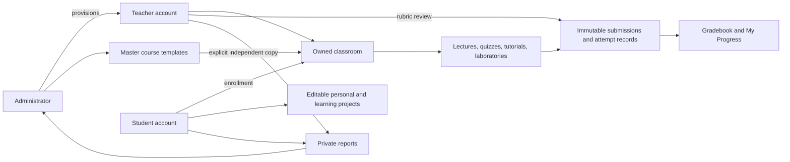
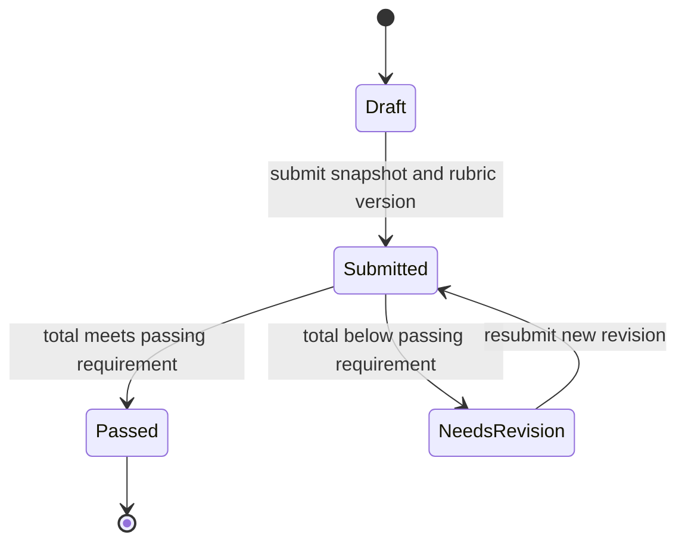
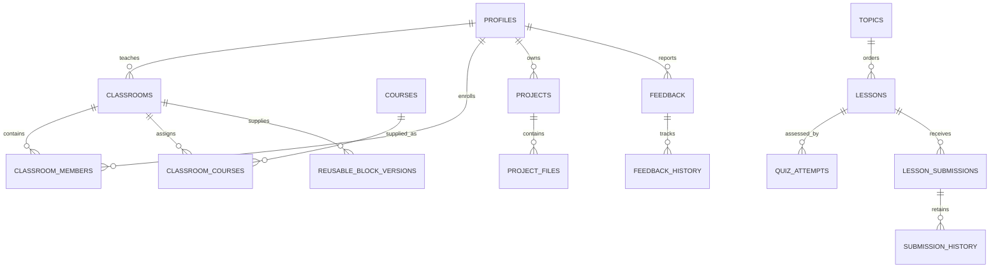

# Implementation model for manuscript revision

Suggested title: **WebbedSite: A Scratch-inspired Visual Programming Environment for HTML, CSS, and JavaScript Education Using Thread-based Block Programming**. Obtain adviser approval for the formal title change and final diagram formatting.

## Scope and account provisioning

WebbedSite is a classroom-based learning environment for front-end HTML, CSS and JavaScript. Students register publicly and enroll in a teacher's classroom. Administrators provision teacher accounts; teachers replace their temporary passwords before classroom access. Administrators maintain master course templates, accounts, reports and analytics. Teachers import independent classroom copies, edit activities, review students and laboratories, and provide reusable block compositions. Students undertake lessons and keep independent personal projects.

## Assessment and progression

Lectures record explicit completion. Tutorials validate guided steps and retain drafts and a completed project. Quizzes are timed, randomized and scored on the server; the best finished attempt is displayed without deleting other attempts. A laboratory has instructions, a published rubric totaling 100 points and a passing requirement (75 by default). Submission grants progression while the score remains null. Teachers review four rubric criteria, supply feedback and mark the calculated result Passed or Needs revision. Revisions preserve prior files, scores, feedback and rubric versions. Existing percentage-only grades remain historical percentages without invented criterion scores.

Lesson sequence, curriculum difficulty, XP level and proficiency are distinct. Proficiency is scoped to a student, classroom and course. Without scored checkpoint evidence it is Not yet assessed. Beginner applies until all foundational and intermediate checkpoint quizzes and laboratories pass. Intermediate then applies; Advanced requires all three tiers. Each tier must contain both a checkpoint quiz and a reviewed laboratory. Pending labs, XP, speed and lecture/tutorial completion cannot independently establish proficiency. These labels describe WebbedSite curriculum performance, not general professional competence.

Teachers may package a connected group of supported blocks from one language into a reusable block. Saved projects carry its version and internal workspace. Custom parameters, arbitrary generator code and recursion are outside this release. Ask the adviser to confirm this interpretation of the panel request.

## Actor and ownership diagram

## Laboratory state diagram

Submitted is shown as Awaiting review. It permits progression; only Passed supplies laboratory mastery. Teacher corrections retain review history.

## Data relationships

This is a conceptual relationship map: the physical quiz relationship passes through `quizzes`, and rubric snapshots are stored on submissions. Use the deployed schema when drawing the complete physical ERD.

## Evaluation boundaries

Automated tests establish specified technical behavior under tested conditions. They do not establish student learning gains, validated proficiency thresholds, usability scores or panel acceptance. Keep the proposed initial diagnostic deferred. Report the real sample, instrument, observations and limitations after evaluation. The starter curriculum contains three levels per subject, each with four activity types; subject-teacher validation remains required.
